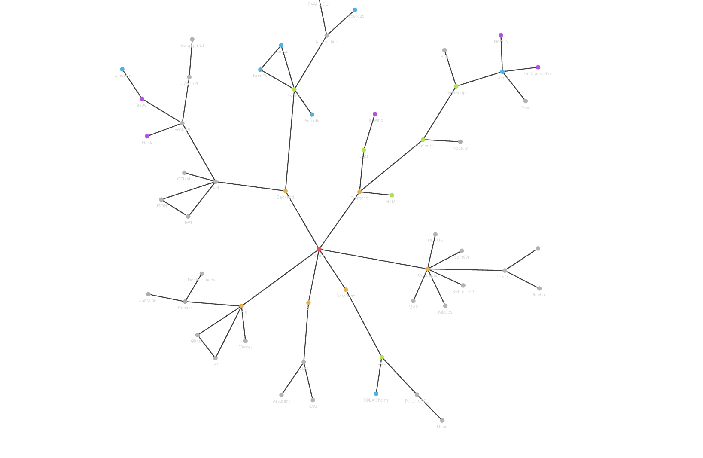

# DeveloperVault

Um cofre de anotações no **Obsidian** para estudar desenvolvimento de software e conectar o que aprendo pelo caminho.

A ideia é simples: transformar estudos, dúvidas e descobertas em notas que possam ser revisitadas e ampliadas. Cada assunto ganha seu espaço, e os links entre as notas ajudam a enxergar como linguagens, ferramentas e conceitos se relacionam. Aos poucos, o cofre se torna um mapa pessoal de conhecimento.

## O que você encontra por aqui

- **Frontend:** HTML, CSS, JavaScript, TypeScript e o ecossistema React.
- **Backend e APIs:** Python, FastAPI, Flask e conceitos de comunicação entre aplicações.
- **Bancos de dados:** SQL, PostgreSQL e ferramentas de acesso a dados.
- **Inteligência artificial:** LLMs, agentes e RAG.
- **Ferramentas e conceitos:** Git, Docker, automação, DevOps e outros assuntos que aparecem durante os estudos.

## Como explorar

Comece pela nota Stack, que funciona como ponto de partida para os principais temas, ou navegue pela [pasta de anotações]. Para acompanhar as conexões e explorar o grafo, abra a pasta deste repositório como um cofre no Obsidian.

As notas usam links no formato `[[Nome da nota]]` para conectar assuntos. O conteúdo está em construção: algumas páginas trazem explicações, enquanto outras servem como pontos de partida para estudos futuros.

## Estado atual do cofre

Cada ponto representa uma nota; cada linha, uma conexão entre assuntos. Este é um registro do grafo atual — um retrato de como os estudos estão ganhando forma.

Se algum tema despertar sua curiosidade, siga as conexões. Uma nota pode ser o começo de uma nova trilha de estudo.
