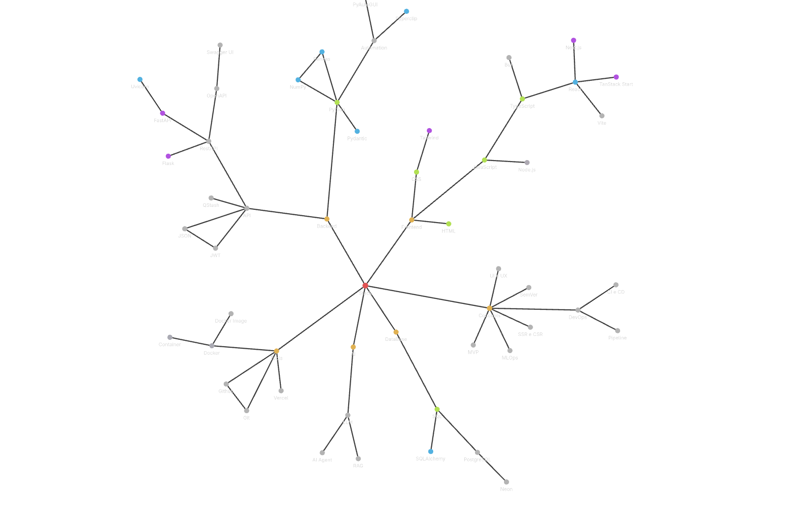

# DeveloperVault

Meu cofre de estudos em desenvolvimento de software: notas organizadas no **Obsidian** e conectadas em um mapa interativo para explorar pelo navegador.

## [↗ Explorar o mapa interativo](https://gabrielcrzojo.github.io/DeveloperVault/)

> **Acesse a visualização online:** [gabrielcrzojo.github.io/DeveloperVault](https://gabrielcrzojo.github.io/DeveloperVault/)
>
> Navegue pelas conexões, filtre por categoria e abra as notas para ler o conteúdo completo.

*A imagem é um registro do grafo. O mapa interativo recebe as alterações das notas a cada publicação no GitHub Pages.*

## O que estou estudando

- **Frontend:** HTML, CSS, JavaScript, TypeScript e o ecossistema React.
- **Backend e APIs:** Python, FastAPI, Flask e comunicação entre aplicações.
- **Bancos de dados:** SQL, PostgreSQL e ferramentas de acesso a dados.
- **Inteligência artificial:** LLMs, agentes e RAG.
- **Ferramentas e conceitos:** Git, Docker, automação, DevOps e outros temas que surgem durante os estudos.

As notas estão em construção: algumas aprofundam um assunto, enquanto outras registram dúvidas ou pontos de partida para aprender mais.

## Como explorar

**Pelo site:** comece pela Stack, siga os fios entre as notas ou encontre um assunto pela busca e pelas categorias. Use a roda do mouse para ampliar, arraste para navegar e clique em uma nota para abrir sua descrição. A estrela centraliza o mapa e repete a animação de construção.

**Pelo repositório:** abra a [nota Stack](Stack/Stack.md) ou navegue pela [pasta de anotações](Stack/).

**No Obsidian:** abra a pasta deste repositório como um cofre. Os links no formato `[[Nome da nota]]` conectam os assuntos e alimentam o grafo.

## Organização

| Caminho | Conteúdo |
| --- | --- |
| [Stack/](Stack/) | Notas e conexões do cofre. |
| [View/](View/) | Visualização web, imagens e arquivos de apoio. |
| [.github/](.github/) | Publicação automática no GitHub Pages. |
| .gitignore | Exclusões de dependências, arquivos gerados e configurações locais. |
| README.md | Apresentação do projeto. |

Para executar o site localmente ou entender a publicação, consulte a [documentação da visualização](View/README.md). Arquivos antigos ficam em `View/archive/` e não entram no site publicado.
